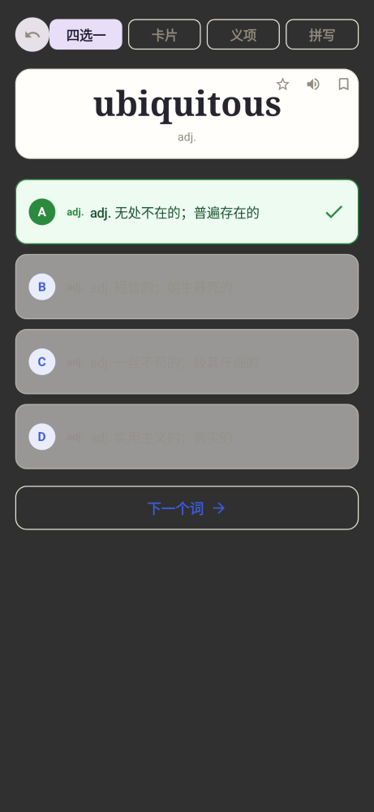
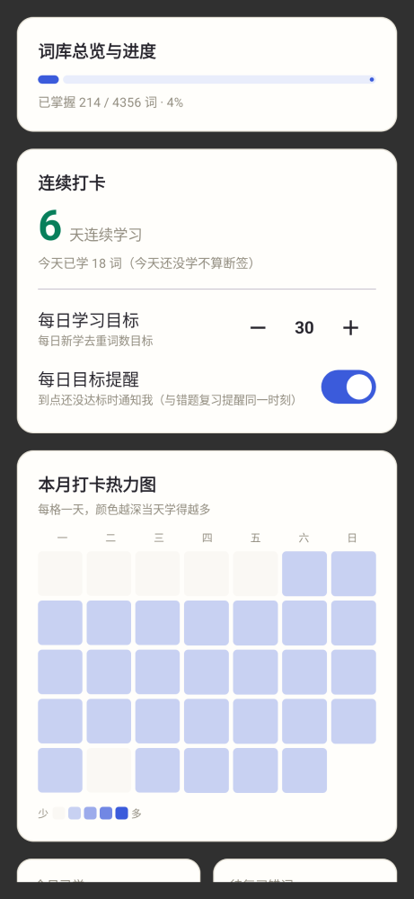
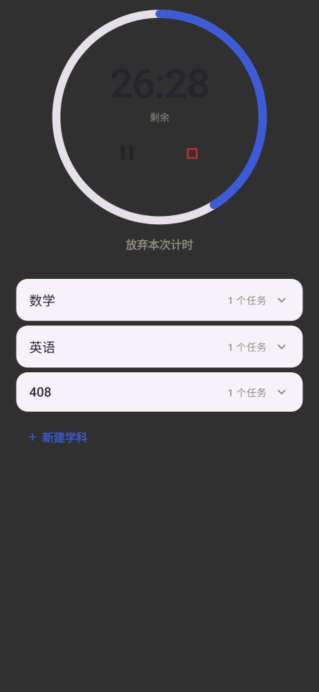
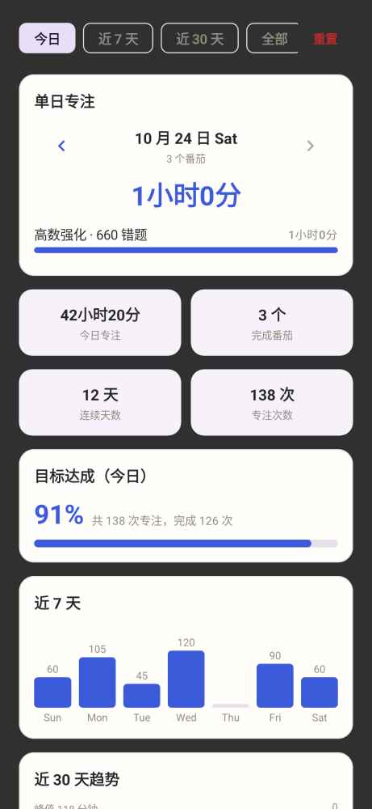

<div align="center">

# 登临 Ascensalis

### 拍下错题它自己认，单词跟着计划背，专注计时还有数据——一个 App 管学习。

**Android 8.0+ · 单机应用 · 不注册账号 · 数据只存在你手机里**

[](LICENSE)
[](https://github.com/ausyeah/ascensalis/actions)
[](https://github.com/ausyeah/ascensalis/releases)
[](https://github.com/ausyeah/ascensalis)

**[下载最新版 APK](https://github.com/ausyeah/ascensalis/releases/latest)** · 直接覆盖安装，不丢数据

</div>

---

## 这是个什么 App

给埋头苦读的人做的一个学习工具箱，目前有四件趁手的工具：

| 工具 | 干什么用 |
|---|---|
| **错题本** | 拍张照、选好题目，App 自动认出文字和公式，大模型顺手帮你整理成标准题型；攒着随时翻，勾选几下就能排版成 A4 打印重做 |
| **AI 对话** | 题目看不懂？直接问。支持多家大模型、能发图片和文档，回答边想边流出；也可以开自由会话随便聊 |
| **背单词** | 四种考法随机出题（认词、选义、拼写、辨析），答错的自动收进复习队列，跟着记忆曲线安排下次见面 |
| **番茄钟** | 专注计时 + 白噪音，按学科记录每次专注；今天学多久、这周什么走势、哪科投入最多，图表一看就知道 |

**不联网也能用**：错题本支持纯手动录入，背单词和番茄钟完全本地。联网能力（题目识别、AI 讲解）需要填自己的 API Key——Key 只存在本机加密空间里，不上传、不进日志。

---

## 截图

> 均为真实设备截图。

### 错题本：从拍照到打印

<table>
<tr>
<td align="center"><br><sub><b>主页</b> · 拍照 / 相册 / PDF / 手动录入</sub></td>
<td align="center"><br><sub><b>裁切</b> · 拖框选题目、框外压暗、涂鸦遮蔽</sub></td>
<td align="center"><br><sub><b>解析中</b> · 上传 → 识别公式表格 → AI 整理</sub></td>
</tr>
<tr>
<td align="center"><br><sub><b>核对</b> · 识别结果逐条编辑</sub></td>
<td align="center"><br><sub><b>补全</b> · 知识点 / 错因 / 难度自己填</sub></td>
<td align="center"><br><sub><b>详情</b> · 题干 / 答案 / 解析对照</sub></td>
</tr>
<tr>
<td align="center"><br><sub><b>题库</b> · 筛选 / 搜索 / 撤销</sub></td>
<td align="center"><br><sub><b>打印</b> · A4 排版完整呈现</sub></td>
</tr>
</table>

### AI 对话：哪题不会问哪题

<table>
<tr>
<td align="center"><br><sub><b>对话</b> · 流式回复，可附图片和文档</sub></td>
<td align="center"><br><sub><b>会话</b> · 每题固定会话 + 自由会话</sub></td>
</tr>
</table>

### 设置与打印预览

<table>
<tr>
<td align="center"><br><sub><b>配置</b> · 填自己的 API Key</sub></td>
<td align="center"><br><sub><b>其他</b> · 图片处理 / 打印默认项 / 提醒</sub></td>
<td align="center"><br><sub><b>打印选项</b> · 含原图 / 答案解析 / 留白重做</sub></td>
</tr>
<tr>
<td align="center"><br><sub><b>预览</b> · 打印前先看排版</sub></td>
<td align="center"><br><sub><b>打印</b> · 走系统打印，边距缩放可调</sub></td>
</tr>
</table>

### 背单词：考法随机出题，答错自动回收

<table>
<tr>
<td align="center"><br><sub><b>刷题</b> · 四选一 / 卡片 / 释义 / 拼写轮着来</sub></td>
<td align="center"><br><sub><b>统计</b> · 打卡热力图 / 连续天数 / 每日目标</sub></td>
</tr>
</table>

### 番茄钟：专注计时 + 数据一目了然

<table>
<tr>
<td align="center"><br><sub><b>计时</b> · 按学科任务记每次专注</sub></td>
<td align="center"><br><sub><b>统计</b> · 今日 / 近 7 天 / 近 30 天趋势</sub></td>
</tr>
</table>

---

## 怎么用起来

1. **下载安装**：[Releases 页面](https://github.com/ausyeah/ascensalis/releases/latest)拿最新 APK，直接装（覆盖安装不丢数据）。
2. **想用完整功能就配 Key**：设置页填两项——
   - **OCR API Key**（题目识别用，支持 MinerU / DeepSeek OCR 等）：[mineru.net](https://mineru.net) 注册领取；
   - **大模型 API**（AI 整理和讲解用）：任何 OpenAI 兼容接口都行（DeepSeek、通义、Kimi 等均可），填 Base URL + Key + 模型名。
3. **不想配也能用**：手动录入错题、背单词、番茄钟，全部本地可用。

> 两个 Key 都只存在本机加密存储（EncryptedSharedPreferences），卸载即彻底消失。

---

## 给开发者

**技术栈**：Kotlin + Jetpack Compose + Room + DataStore；公式渲染用 KaTeX（WebView 光栅化）；大模型走 SSE 流式；发布走 GitHub Actions 签名构建。

**模块地图**：

```
app/src/main/java/com/mistakebook/
├── data/        # 数据库、偏好存储、备份
├── net/         # OCR / 大模型客户端
├── pipeline/    # 识别流水线、LaTeX 修复
├── math/        # 公式渲染（KaTeX + 位图裁切）
├── pomodoro/    # 番茄钟与统计
├── wordbook/    # 背单词
├── print/       # A4 导出排版
└── ui/          # 各功能界面（Compose）
```

**本地构建与测试**：

```bash
./gradlew assembleDebug        # 构建 Debug 包
./gradlew testDebugUnitTest    # 跑单元测试（687 个用例）
./gradlew assembleRelease      # 构建正式签名包（需 local.properties 配好签名信息）
```

**测试说明**：渲染链路有契约测试守着——`MathHtmlContractTest` 会检查公式渲染函数不允许被改成异步形式（历史上这么改出过全量渲染失败的故障，见提交记录里的 `P0 热修复`）。

---

## 数据与安全

- **不预置任何 API Key**：公开安装包里没有任何人的密钥，Key 由使用者自己填；
- **Key 只存本机**：加密存储，不进日志、不随备份外泄；
- **仓库里没有密钥文件**：签名密钥本体只在维护者本地与 CI Secrets 里，仓库内只有占位模板；
- **升级不丢数据**：正式签名发布，新旧版本直接覆盖安装。

## 许可证

[MIT](LICENSE)。随包分发的第三方组件（KaTeX 及其字体，MIT）见 [THIRD_PARTY_LICENSES.md](THIRD_PARTY_LICENSES.md)。

## 免责声明

本项目仅提供客户端能力。OCR 服务（MinerU 等）与大模型 API 均为第三方服务，账号注册、配额与费用由使用者自行承担；请在使用前阅读并遵守相应服务条款。
