<div align="center">

# 登临 Ascensalis

### 拍下错题它自己认，单词跟着计划背，专注计时还有数据——一个 App 管学习。

**Android 8.0+ · 单机应用 · 不注册账号 · 数据只存在你手机里**

[](LICENSE)
[](https://github.com/ausyeah/ascensalis/actions)
[](https://github.com/ausyeah/ascensalis/releases)
[](https://github.com/ausyeah/ascensalis)

**[下载最新版 APK](https://github.com/ausyeah/ascensalis/releases/latest)** · 直接覆盖安装，不丢数据

</div>

---

## 这是个什么 App

给埋头苦读的人做的一个学习工具箱，目前有这些趁手的工具：

| 工具 | 干什么用 |
|---|---|
| **错题本** | 拍张照、选好题目，App 自动认出文字和公式，大模型顺手帮你整理成标准题型；攒着随时翻，勾选几下就能排版成 A4 打印重做 |
| **AI 对话** | 题目看不懂？直接问。多渠道多 Key 大模型、能发图片和文档、支持联网搜索与生图，回答边想边流出；也可以开临时会话随手问 |
| **记忆** | 让它长期记住你的背景、目标和偏好：一句话交给模型改写成分节文档，每轮对话自动带上 |
| **资料库** | 把教材、讲义、试卷（md / txt / pdf / docx）存进 App，对话时 @ 它让 AI 参考；建好向量索引后**语义检索**——用中文问，英文资料也能命中 |
| **背单词** | 四种考法随机出题（认词、选义、拼写、辨析），答错的自动收进复习队列，跟着记忆曲线安排下次见面 |
| **番茄钟** | 专注计时 + 白噪音，按学科记录每次专注；今天学多久、这周什么走势、哪科投入最多，图表一看就知道；归档任务可随时找回 |
| **成就墙** | 100 枚徽章覆盖刷题、专注、背单词、对话、资料库与使用习惯，学习里程碑一眼可见 |

**不联网也能用**：错题本支持纯手动录入，背单词、番茄钟完全本地。联网能力（题目识别、AI 讲解、生图）需要填自己的 API Key——Key 只存在本机加密空间里，不上传、不进日志。

---

## 截图

> 均为 Android 模拟器实拍，示例内容为虚构数据。

### 错题本：拍照识别 → 题库 → 打印

<table>
<tr>
<td align="center">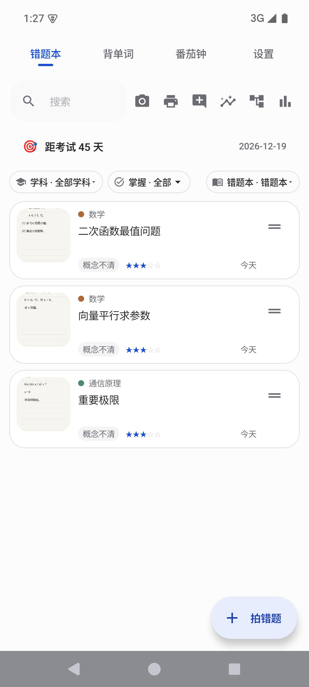<br><sub><b>主页</b> · 考试倒计时 / 搜索 / 拍题入口</sub></td>
<td align="center"><br><sub><b>题库</b> · 筛选 / 搜索 / 左滑置顶与归档</sub></td>
<td align="center">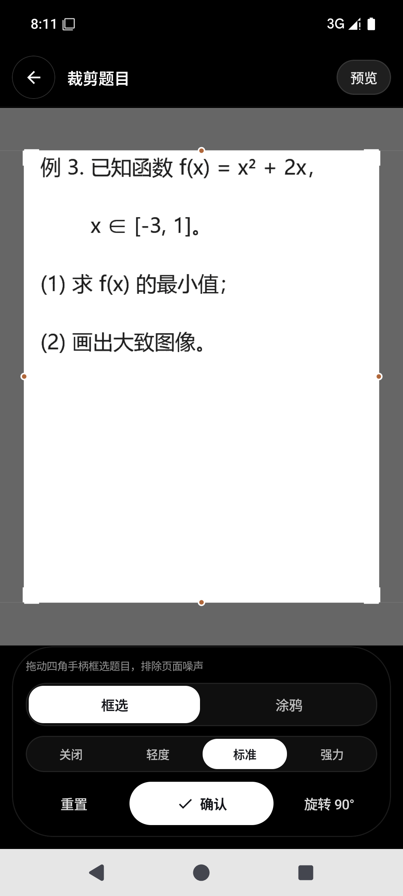<br><sub><b>裁切</b> · 拖框选题目、框外压暗、图像增强</sub></td>
</tr>
<tr>
<td align="center"><br><sub><b>核对</b> · 识别结果逐条编辑</sub></td>
<td align="center">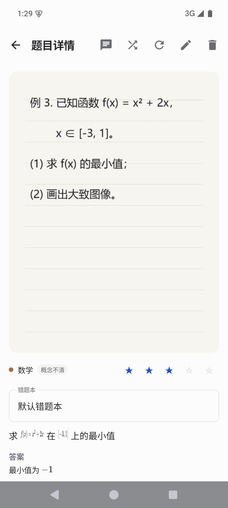<br><sub><b>详情</b> · 原题图 / 题干 / 答案 / 解析</sub></td>
<td align="center">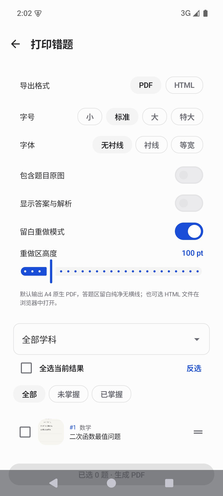<br><sub><b>打印</b> · 字号字体 / 答案 / 留白重做</sub></td>
</tr>
</table>

### AI 对话：哪题不会问哪题

<table>
<tr>
<td align="center">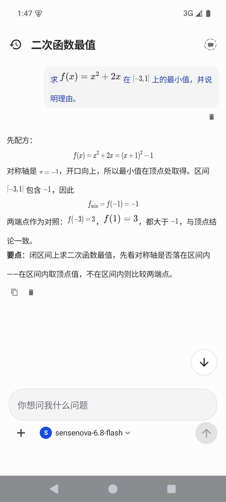<br><sub><b>对话</b> · 流式回复，公式逐条渲染</sub></td>
<td align="center">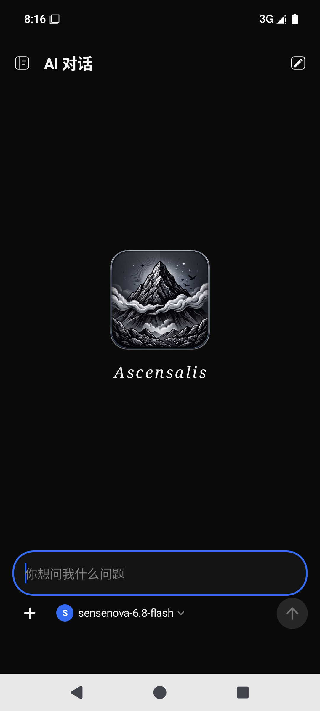<br><sub><b>临时对话</b> · 退出即归档，可再找回</sub></td>
<td align="center">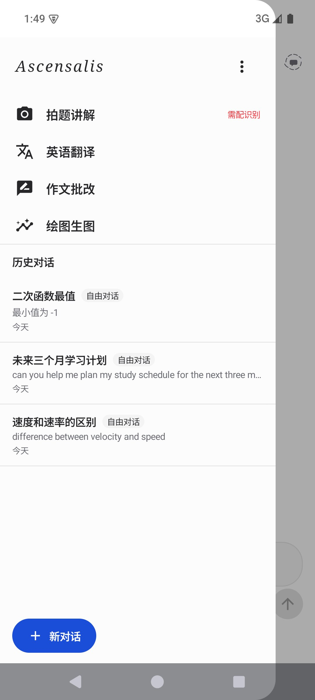<br><sub><b>历史</b> · 抽屉式列表，左滑置顶 / 重命名 / 归档（无缝圆角拼贴）</sub></td>
</tr>
</table>

### 资料库与记忆：给 AI 挂上你的资料和背景

<table>
<tr>
<td align="center">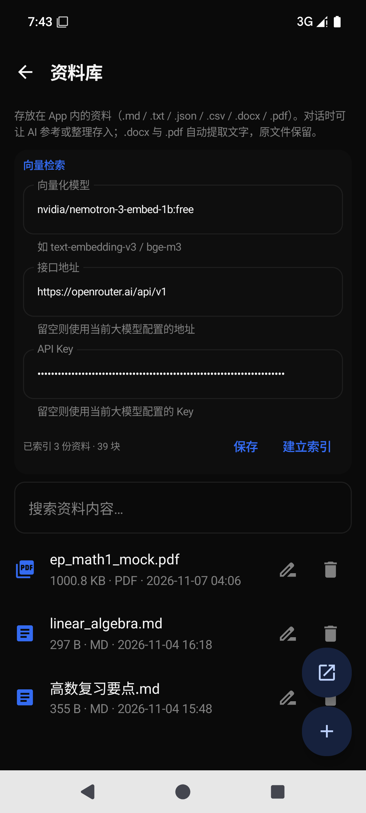<br><sub><b>资料库</b> · 教材讲义入库，向量化后语义检索</sub></td>
<td align="center">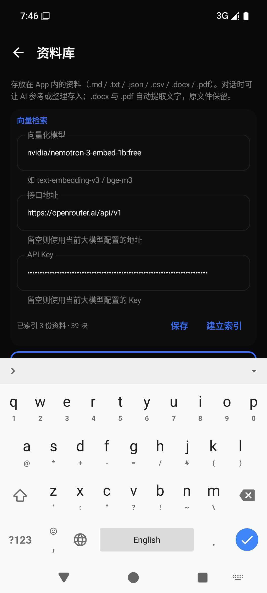<br><sub><b>语义检索</b> · 向量 + 关键词融合排序</sub></td>
<td align="center">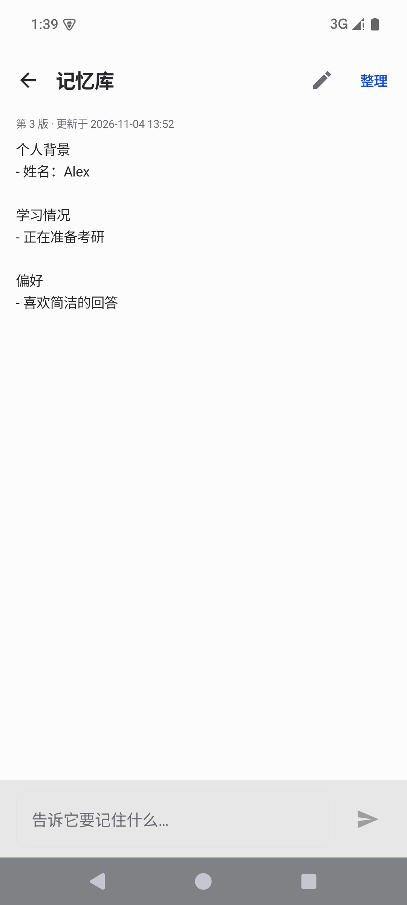<br><sub><b>记忆库</b> · 整篇分节文档，每轮对话自动带上</sub></td>
</tr>
</table>

### 背单词：考法随机出题，答错自动回收

<table>
<tr>
<td align="center">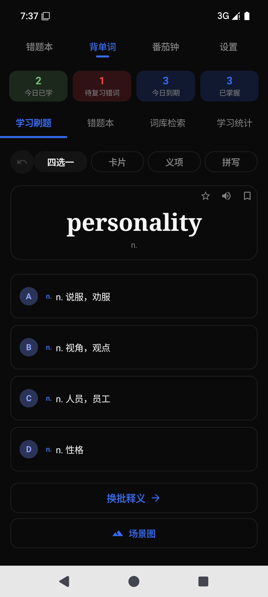<br><sub><b>刷题</b> · 四选一 / 卡片 / 释义 / 拼写轮着来</sub></td>
<td align="center">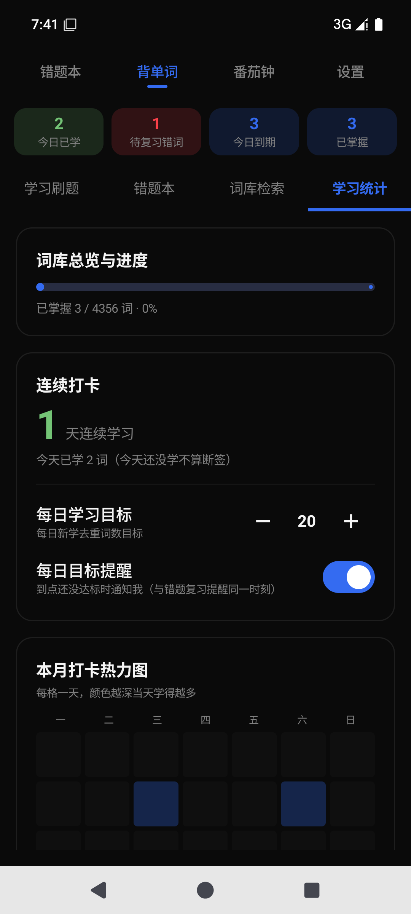<br><sub><b>统计</b> · 词库进度 / 连续打卡 / 月度热力图</sub></td>
</tr>
</table>

### 番茄钟与成就：专注有数，里程碑可见

<table>
<tr>
<td align="center">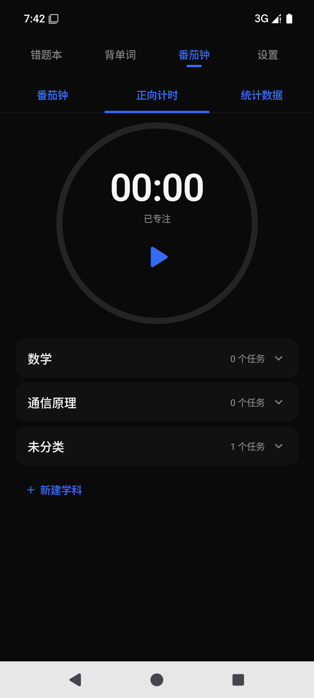<br><sub><b>计时</b> · 按学科任务记每次专注</sub></td>
<td align="center">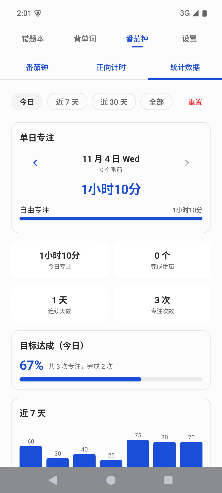<br><sub><b>统计</b> · 今日 / 近 7 天 / 近 30 天趋势</sub></td>
<td align="center">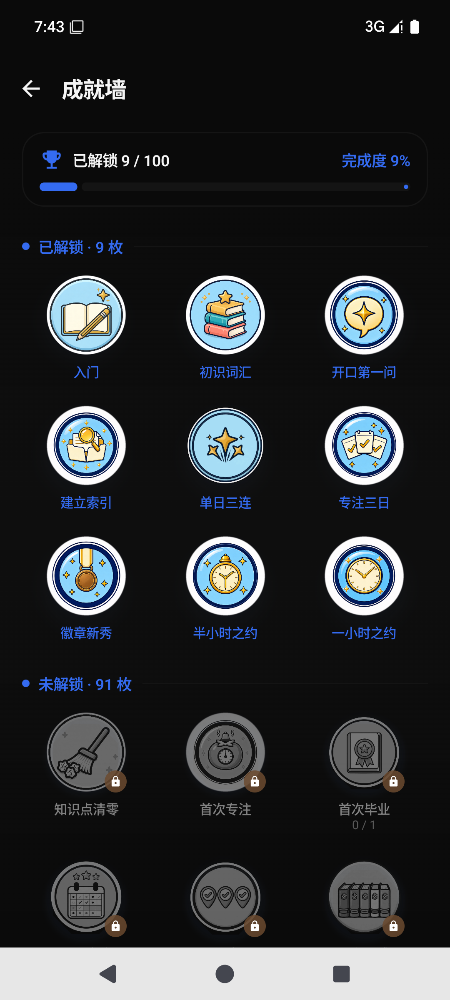<br><sub><b>成就墙</b> · 100 枚徽章，11 个类别</sub></td>
</tr>
</table>

### 设置：全部自己掌控

<table>
<tr>
<td align="center">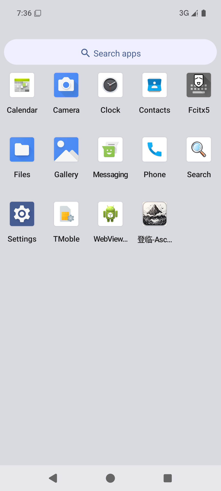<br><sub><b>设置</b> · AI 与识别 / 学习 / 数据 / 通用 四组折叠</sub></td>
<td align="center">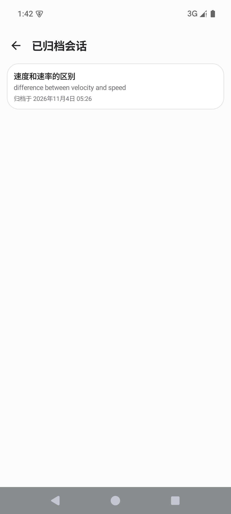<br><sub><b>已归档</b> · 归档会话 / 题目 / 任务都可恢复</sub></td>
<td align="center"><br><sub><b>批量导入</b> · 相册多选 / PDF 逐页提取</sub></td>
</tr>
</table>

---

## 怎么用起来

1. **下载安装**：[Releases 页面](https://github.com/ausyeah/ascensalis/releases/latest)拿最新 APK，直接装（覆盖安装不丢数据）。
2. **想用完整功能就配 Key**（设置 → AI 与识别）：
   - **OCR 渠道**（题目识别）：[MinerU](https://mineru.net) 官方渠道，或任意 OpenAI 兼容的视觉模型（DeepSeek OCR、商汤日日新、Qwen-VL 等）；
   - **大模型**（AI 整理和讲解）：任何 OpenAI 兼容接口都行，支持**一个地址下多把 Key 自动换切**，填 Base URL + Key + 模型名；
   - **联网搜索**（可选）：Tavily 或 DeepSeek 搜索；
   - **资料库向量化**（可选）：任意 OpenAI 兼容 embeddings 接口。
3. **国内服务直连**：内置网络路由——MinerU、商汤等国内供应商自动直连不走代理，长期挂 VPN 也不影响识别。
4. **不想配也能用**：手动录入错题、背单词、番茄钟，全部本地可用。

> 所有 Key 都只存在本机加密存储（EncryptedSharedPreferences），卸载即彻底消失。

---

## 给开发者

**技术栈**：Kotlin + Jetpack Compose + Room + DataStore；公式渲染用 KaTeX（WebView 光栅化）；大模型走 SSE 流式；发布走 GitHub Actions 签名构建。

**模块地图**：

```
app/src/main/java/com/mistakebook/
├── data/        # 数据库、偏好存储、备份、资料库索引
├── net/         # OCR / 大模型 / 嵌入 / 搜索客户端，网络路由
├── pipeline/    # 识别流水线、LaTeX 修复
├── math/        # 公式渲染（KaTeX + 位图裁切）
├── pomodoro/    # 番茄钟与统计
├── wordbook/    # 背单词
├── print/       # A4 导出排版
└── ui/          # 各功能界面（Compose）
```

**本地构建与测试**：

```bash
./gradlew assembleDebug        # 构建 Debug 包
./gradlew testDebugUnitTest    # 跑单元测试（1600+ 用例）
./gradlew assembleRelease      # 构建正式签名包（需 local.properties 配好签名信息）
```

**测试说明**：渲染链路有契约测试守着——`MathHtmlContractTest` 会检查公式渲染函数不允许被改成异步形式（历史上这么改出过全量渲染失败的故障，见提交记录里的 `P0 热修复`）；左滑手势、识别流水线的 Key 读取等行为契约也各有专属测试钉着。

**项目文档**（`docs/`）：

| 文档 | 内容 |
|---|---|
| [CHANGELOG.md](docs/CHANGELOG.md) | 逐版本更新记录，与 GitHub Releases 同步 |
| [HANDOFF.md](docs/HANDOFF.md) | 接手本项目的完整上下文（当前状态、硬性规则、常见坑） |
| [DECISIONS.md](docs/DECISIONS.md) | 架构与功能的设计决策及其取舍理由 |
| [OPTIMIZATION_NOTES.md](docs/OPTIMIZATION_NOTES.md) | 性能优化任务的动机、测量数据与取舍 |
| [RENDER-TEST-PROMPT.md](docs/RENDER-TEST-PROMPT.md) | 渲染链路的实测提示词与验收表 |

---

## 数据与安全

- **不预置任何 API Key**：公开安装包里没有任何人的密钥，Key 由使用者自己填；
- **Key 只存本机**：加密存储，不进日志、不随备份外泄；
- **仓库里没有密钥文件**：签名密钥本体只在维护者本地与 CI Secrets 里，仓库内只有占位模板；
- **升级不丢数据**：正式签名发布，新旧版本直接覆盖安装；
- **记忆与资料只在本机**：记忆文档、资料库与其向量索引存在本地，随卸载一并消失，不上传任何服务器。

## 许可证

[MIT](LICENSE)。随包分发的第三方组件（KaTeX 及其字体，MIT）见 [THIRD_PARTY_LICENSES.md](THIRD_PARTY_LICENSES.md)。

## 免责声明

本项目仅提供客户端能力。OCR 服务（MinerU 等）与大模型 API 均为第三方服务，账号注册、配额与费用由使用者自行承担；请在使用前阅读并遵守相应服务条款。
